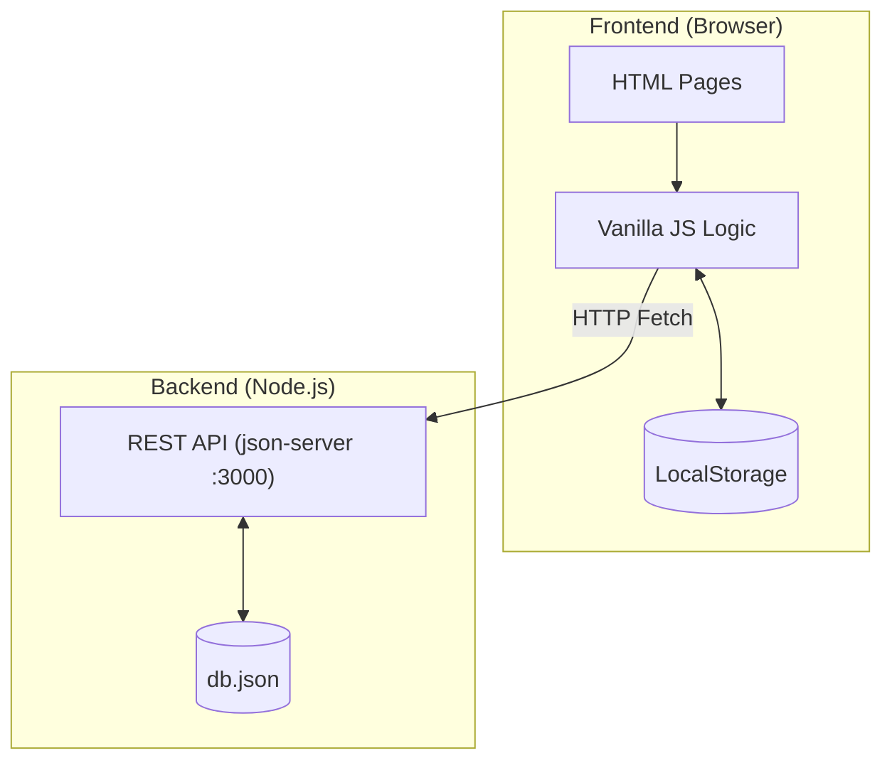
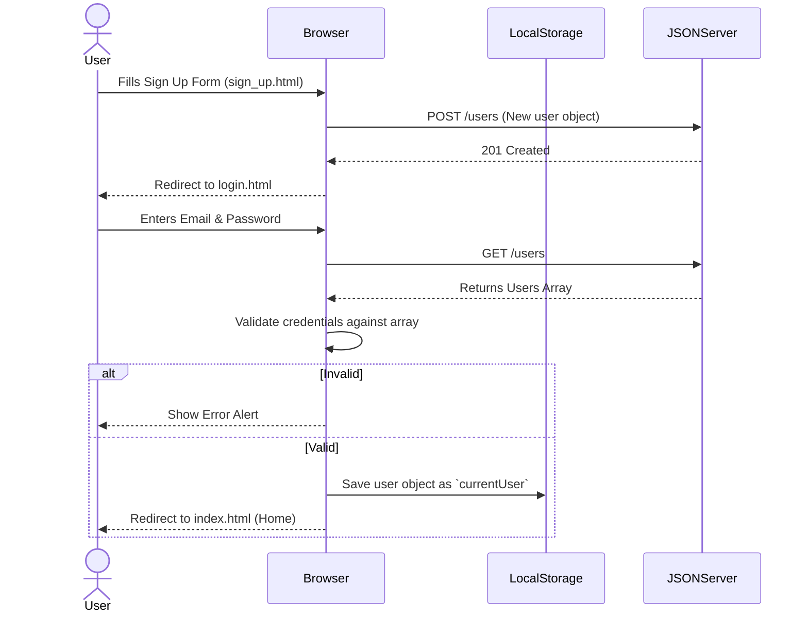
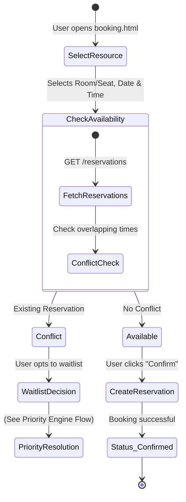
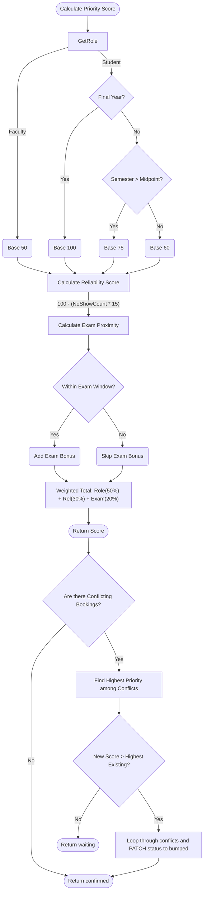
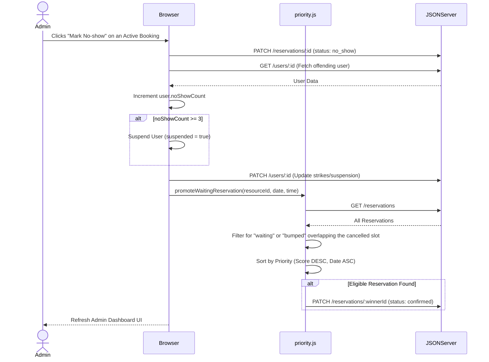

<div align="center">
<pre>
 █████╗ ████████╗██╗      █████╗ ███████╗    ██████╗  ██████╗  ██████╗ ███╗   ███╗
██╔══██╗╚══██╔══╝██║     ██╔══██╗██╔════╝    ██╔══██╗██╔═══██╗██╔═══██╗████╗ ████║
███████║   ██║   ██║     ███████║███████╗    ██████╔╝██║   ██║██║   ██║██╔████╔██║
██╔══██║   ██║   ██║     ██╔══██║╚════██║    ██╔══██╗██║   ██║██║   ██║██║╚██╔╝██║
██║  ██║   ██║   ███████╗██║  ██║███████║    ██║  ██║╚██████╔╝╚██████╔╝██║ ╚═╝ ██║
╚═╝  ╚═╝   ╚═╝   ╚══════╝╚═╝  ╚═╝╚══════╝    ╚═╝  ╚═╝ ╚═════╝  ╚═════╝ ╚═╝     ╚═╝
</pre>

  
  
  
  <br/><br/>
  <a href="https://library-management-system-g2806haix.vercel.app/" target="_blank">
    
  </a>
  <br/><br/>
  
</div>

<br />

Welcome to **Atlas Room**! A modern, smart **library seat reservation system** built entirely with **Vanilla JavaScript**. It ensures fair access to limited seating and academic resources using a dynamic **Priority Engine** that replaces traditional, easily-exploited First-Come-First-Serve (FCFS) systems. 

---

## Table of Contents
- [Features](#features)
- [Tech Stack](#tech-stack)
- [Architecture & System Flows](#architecture--system-flows)
- [REST API Reference](#rest-api-reference)
- [Project Structure](#project-structure)
- [Future Roadmap](#future-roadmap)
- [Getting Started](#getting-started)
- [Contributing](#contributing)
- [Acknowledgements](#acknowledgements)

---

## Features
* **Dynamic Priority Engine:** Ranks users based on Academic Role (50%), Historical Reliability (30%), and Exam Proximity (20%).
* **Smart Waitlist & Auto-Bumping:** High-priority users can bump lower-priority occupants to the waitlist when the library is fully booked.
* **Anti-Cheat & Reliability Tracking:** No-shows instantly drop a user's reliability score ("strikes"). Three strikes trigger an automatic suspension.
* **Admin Telemetry Dashboard:** Live room occupancy meters, Guardian Hold message management, and Force Confirm capabilities.
* **Premium UI:** Glassmorphism UI, interactive golden constellation animations, and dark-mode aesthetics.

---

## Tech Stack
* **Frontend:** HTML5, CSS3, **Vanilla JavaScript (ES6)**
* **Design:** Custom CSS Variables, Flexbox/Grid, Glassmorphism
* **Backend:** [`json-server`](https://github.com/typicode/json-server) (Provides a full REST API on port `3000`)
* **State:** Browser `localStorage`

---

## Architecture & System Flows

Below is the complete architectural breakdown of the Atlas Room system. **Click any section to expand and explore the interactive flowcharts!**

<details>
<summary><b>1. High-Level Architecture</b></summary>
<br/>

This diagram illustrates the core components of the system and how the Vanilla JS frontend communicates with the lightweight `json-server` backend.


</details>

<details>
<summary><b>2. User Authentication Flow</b></summary>
<br/>

The complete lifecycle for signing up, logging in securely, and maintaining session state entirely on the client-side.


</details>

<details>
<summary><b>3. Booking Engine Flow</b></summary>
<br/>

How users reserve a seat and are placed into the system, including conflict resolution triggers.


</details>

<details>
<summary><b>4. Priority Engine & Bumping Algorithm</b></summary>
<br/>

The core algorithm! A detailed breakdown of how a user's priority score is calculated dynamically and how conflicts are resolved when multiple people want the same seat.


</details>

<details>
<summary><b>5. Admin & Telemetry Operations</b></summary>
<br/>

How administrators monitor the library, handle no-shows, and manage the automated waitlist promotion lifecycle.


</details>

---

## REST API Reference

The local `json-server` backend runs on `http://localhost:3000` and provides the following RESTful endpoints:

| Endpoint | Method | Description |
|---|---|---|
| `/users` | `GET`, `POST` | Fetch user directory or register a new user. |
| `/users/:id` | `PATCH` | Update user telemetry (e.g., add no-show strikes, suspend). |
| `/resources` | `GET` | Fetch all available library seats/rooms and their capacities. |
| `/reservations` | `GET`, `POST` | Fetch booking grid or submit a new reservation. |
| `/reservations/:id` | `PATCH` | Update booking status (`confirmed`, `bumped`, `waiting`, `no_show`). |
| `/examWindows` | `GET` | Fetch active university examination periods for priority calculations. |

---

## Project Structure

```text
library-management-system/
├── db.json                 # JSON Server database (users, reservations, resources)
├── package.json            # Node project configuration
├── README.md               # You are here
└── frontend/               # Vanilla JS Frontend Application Root
    ├── index.html          # Landing page & Priority Engine Simulator
    ├── booking.html        # Main resource reservation interface
    ├── myBooking.html      # User's active/past reservations dashboard
    ├── profile.html        # User stats and reliability breakdown
    ├── login.html          # Authentication - Login
    ├── sign_up.html        # Authentication - Sign Up
    ├── admin.html          # Administrator Telemetry Dashboard
    ├── about.html          # Team and project information
    ├── css/                # Stylesheets (app.css, index.css, admin.css)
    ├── js/                 # Vanilla JS Logic layer
    │   ├── script.js       # Global auth state and UI utilities
    │   ├── priority.js     # Core priority algorithms & waitlist promotion logic
    │   ├── adminPanel.js   # Admin dashboard telemetry and data grids
    │   └── adminNav.js     # Admin tab routing
    └── images/             # Static assets and video tours
```

---

## Future Roadmap
We are actively developing Atlas Room to be the ultimate resource management tool. Here is what's coming next:
- [ ] **Automated Suspensions:** Instantly lock accounts that accumulate 3+ No-Show strikes.
- [ ] **Waitlist Position Visibility:** Allow users to see their real-time rank on the waitlist in their dashboard.
- [ ] **Smart Slot Suggestions:** Suggest alternative times/rooms when a user's choice is fully booked.
- [ ] **Self Check-In Protocol:** Require users to verify their presence via a check-in code within 15 minutes of booking start.

---

## Getting Started

### 1. Prerequisites
You will need [Node.js](https://nodejs.org/) installed on your machine to run the mock backend.

### 2. Start the Backend API
We use `json-server` to mock the REST backend. Open a terminal in the root directory and run:
```bash
npx json-server db.json
```
*(Keep this terminal window running in the background).*

### 3. Launch the Frontend
Since the entire frontend is built with **Vanilla JS**, there is no build step! 
- Simply double-click `frontend/index.html` in your file explorer to open it in your browser.
- Alternatively, use an extension like **Live Server** in VS Code for hot-reloading.

---

## Contributing

Contributions, issues, and feature requests are welcome! 
Feel free to check the issues page if you want to contribute to the priority engine or suggest new features.

1. Fork the Project
2. Create your Feature Branch (`git checkout -b feature/AmazingFeature`)
3. Commit your Changes (`git commit -m 'Add some AmazingFeature'`)
4. Push to the Branch (`git push origin feature/AmazingFeature`)
5. Open a Pull Request

---

## Acknowledgements

Developed for institutions seeking modern, fair, and intelligent resource allocation. 
If you find this project helpful, please consider giving it a star on GitHub!

---
<br />
<div align="center">
  <b>Atlas Room</b> - Redefining the Library Experience.
</div>
<br />

